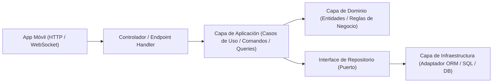

# GUÍA MAESTRA DE ARQUITECTURA BACKEND Y BUENAS PRÁCTICAS

Esta guía establece los principios de diseño de backend para garantizar APIs robustas, escalables, seguras y perfectamente sincronizadas con la aplicación móvil.

---

## 1. Clean Architecture y Arquitectura Hexagonal

Todo backend debe desacoplar el transporte HTTP y la base de datos de la lógica de negocio central:



### Reglas Clave:
1. **Validación Temprana (Fail-Fast)**: Ningún dato corrupto o mal formado debe alcanzar el caso de uso. Los controladores validan los esquemas de entrada antes de invocar la lógica de negocio.
2. **Respuestas de Error Estandarizadas (RFC 7807 Problem Details)**:
   Los errores no deben devolverse como texto plano ni con estructuras ad-hoc. Deben seguir el estándar:
   ```json
   {
     "type": "https://miapp.com/errors/invalid-credentials",
     "title": "Credenciales inválidas",
     "status": 401,
     "detail": "El correo o contraseña no coinciden.",
     "instance": "/api/v1/auth/login",
     "code": "AUTH_INVALID_CREDENTIALS"
   }
   ```

---

## 2. Guía por Tecnologías de Backend

### A. ASP.NET Core Web API (C#) — *Máxima Sinergia con .NET MAUI*
- **Ventaja Diferencial**: Si la app móvil es .NET MAUI o Blazor Hybrid, se puede crear un proyecto de biblioteca de clases .NET estándar (`Shared.Contracts`) que contiene los DTOs, interfaces y validadores, compartido directamente tanto por la app móvil como por el backend sin duplicar código.
- **Estructura Recomendada**:
  - `Api`: Controllers (o Minimal APIs), Middlewares, Swagger/OpenAPI.
  - `Application`: Casos de uso implementados con MediatR (CQRS) o servicios de aplicación directos, FluentValidation.
  - `Domain`: Entidades ricas, Value Objects, Excepciones de dominio.
  - `Infrastructure`: Entity Framework Core (DbContext, Migraciones transaccionales), repositorios, implementaciones de correo/almacenamiento.
  - `Shared`: Contratos DTOs y validadores compartidos con la app móvil.

### B. Node.js / TypeScript (NestJS o Fastify)
- **Ventaja**: Si la app móvil es React Native (Expo), se comparte TypeScript de extremo a extremo con esquemas Zod o class-validator.
- **Patrón**: Módulos desacoplados en NestJS (`AuthModule`, `UsersModule`, etc.) con inyección de dependencias, DTOs con `class-validator`, y Prisma / Drizzle ORM para acceso tipado a base de datos.

### C. Python (FastAPI)
- **Ventaja**: Desarrollo ultrarrápido, tipado estricto con Pydantic v2, generación automática de esquemas OpenAPI (`/docs` y `/redoc`), ideal para procesamiento de datos o integración con modelos de IA.
- **Patrón**: Clean Architecture con routers modulares en `app/api/v1/`, modelos Pydantic para entrada/salida y SQLAlchemy 2.0 (async) o SQLModel para persistencia.

### D. Go (Golang con Gin / Fiber / Chi)
- **Ventaja**: Rendimiento nativo supremo, baja latencia, compilación en un binario ligero sin dependencias externas, concurrencia masiva con goroutines.
- **Patrón**: Paquetes por dominio o arquitectura limpia estándar (`cmd/api/main.go`, `internal/domain/`, `internal/service/`, `internal/repository/`, `internal/handler/`).

### E. Supabase / PostgreSQL BaaS
- **Ventaja**: Velocidad récord de lanzamiento (*Time-to-market*).
- **Patrón**: Base de datos PostgreSQL con políticas estrictas de seguridad a nivel de fila (**RLS - Row Level Security**), Auth con tokens JWT verificados en cliente, Edge Functions en Deno/TypeScript para lógica de servidor personalizada.

---

## 3. Principio "Contract-First" (Contrato Primero)

Para evitar desincronizaciones entre el equipo/código móvil y el backend:
1. **Definir el Contrato Antes de Programar**: Se define el esquema OpenAPI (Swagger) o la biblioteca de DTOs compartida antes de implementar la UI móvil o los controladores de backend.
2. **Generación de Clientes**:
   - Para Dart/Flutter: Generación automática de modelos y cliente HTTP con `openapi-generator` o `retrofit`.
   - Para TypeScript/React Native: Generación de hooks de React Query con `openapi-typescript` o `orval`.
   - Para .NET MAUI: Referencia directa a la librería de contratos compartida `Shared.Contracts.dll` o generación con `NSwag`.
   - Para Kotlin/Swift: Generación de clientes tipados con plugins de OpenAPI.
