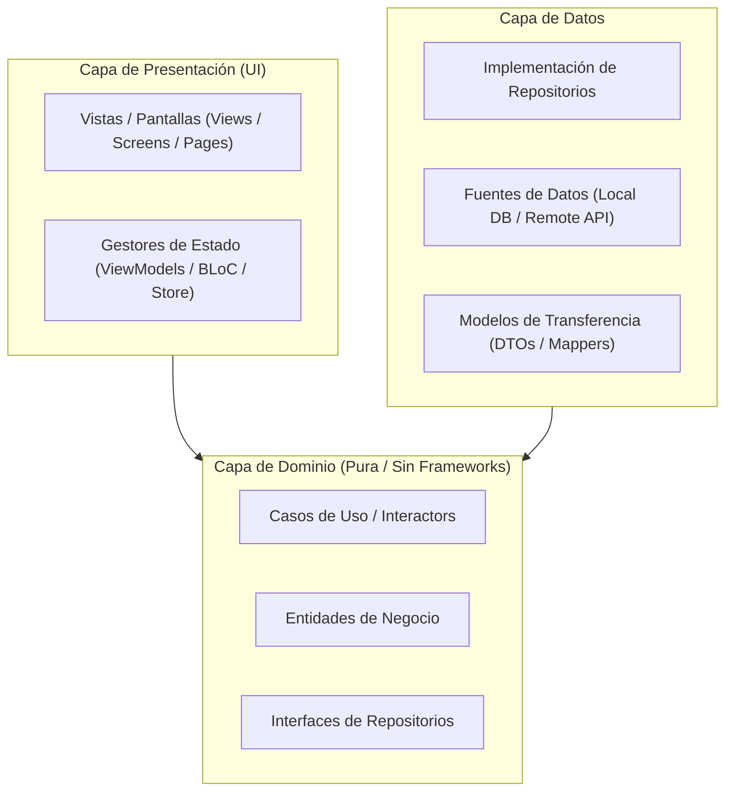

# GUÍA MAESTRA DE ARQUITECTURA MÓVIL Y BUENAS PRÁCTICAS

Esta guía recopila los estándares arquitectónicos y patrones de diseño obligatorios para el desarrollo de la aplicación móvil en este repositorio, sin importar el framework elegido.

---

## 1. Clean Architecture en el Cliente Móvil

Toda aplicación móvil debe estructurarse en **tres capas concéntricas con regla de dependencia hacia adentro**:



### Reglas Clave:
1. **La Capa de Dominio es Pura**: No debe importar paquetes de UI (como `Flutter Widgets`, `React Native components`, `Android Views`, `SwiftUI` o `Microsoft.Maui.Controls`). Solo contiene lógica pura y tipos de datos de negocio.
2. **Inversión de Dependencias**: La capa de dominio define la interfaz del repositorio (`IUserRepository`), y la capa de datos la implementa (`UserRepositoryImpl`).
3. **Mapeo Explícito**: Los modelos que vienen del servidor (DTOs/JSON) se transforman a entidades de dominio mediante mappers explícitos. Si el backend cambia el nombre de una clave JSON, solo cambia el DTO, no la entidad ni la UI.

---

## 2. Guía por Tecnologías y Ecosistemas Móviles

### A. Ecosistema .NET / C# (.NET MAUI, Blazor Hybrid, Uno Platform)
- **Patrón Principal**: **MVVM (Model-View-ViewModel)** utilizando el paquete oficial `CommunityToolkit.Mvvm`.
- **Estructura Recomendada**:
  ```text
  App/
  ├── Features/
  │   └── Authentication/
  │       ├── Models/
  │       ├── ViewModels/ (LoginPageViewModel.cs con [ObservableProperty] y [RelayCommand])
  │       ├── Views/ (LoginPage.xaml y LoginPage.xaml.cs)
  │       └── Services/
  ├── Core/
  │   ├── Database/ (SQLite-net-pcl o EF Core SQLite)
  │   ├── Network/ (HttpClient tipado con Polly para reintentos)
  │   └── Security/ (Microsoft.Maui.Storage.SecureStorage para tokens)
  └── MauiProgram.cs (Inyección de dependencias con builder.Services)
  ```
- **Blazor Hybrid**:
  - Los componentes `.razor` se ubican en proyectos de biblioteca de clases Razor (RCL) compartidos.
  - La app MAUI aloja un `BlazorWebView` y expone servicios nativos inyectados vía C#.
- **Uno Platform / Avalonia UI**:
  - Se sigue el patrón MVVM o MVI (Model-View-Intent) con enlace de datos XAML / C# Markup.

### B. Flutter (Dart)
- **Patrón Principal**: **BLoC (Business Logic Component)** o **Riverpod**.
- **Estructura Recomendada**:
  ```text
  lib/
  ├── core/ (network, errors, usecases, theme)
  ├── features/
  │   └── auth/
  │       ├── data/ (datasources, models, repositories)
  │       ├── domain/ (entities, repositories, usecases)
  │       └── presentation/ (bloc/cubit, pages, widgets)
  └── main.dart
  ```
- **Persistencia y Red**: `Dio` con interceptor para refresh token, `Drift` (SQLite tipado) o `Hive` para caché offline, `flutter_secure_storage` para claves.

### C. React Native con Expo (TypeScript)
- **Patrón Principal**: Componentes funcionales, custom hooks para lógica de negocio y **Zustand** o **Redux Toolkit** para estado global, junto con **TanStack React Query** para estado de servidor.
- **Estructura Recomendada**:
  ```text
  src/
  ├── api/ (cliente Axios/Fetch con interceptores)
  ├── components/ (UI desacoplada y reutilizable)
  ├── features/ (módulos verticales con screens, hooks y servicios)
  ├── storage/ (Expo SQLite o MMKV, expo-secure-store)
  └── App.tsx
  ```

### D. Nativo Android (Kotlin + Jetpack Compose)
- **Patrón Principal**: **MVI / MVVM** con `StateFlow` y eventos unidireccionales (UDF).
- Inyección de dependencias con **Hilt** o **Koin**.
- Persistencia local con **Room Database** y almacenamiento seguro con **EncryptedSharedPreferences** / KeyStore.

### E. Nativo iOS (Swift + SwiftUI)
- **Patrón Principal**: **MVVM** moderno con protocolo `@Observable` (iOS 17+) o `ObservableObject`, concurrencia estructurada con `async/await` y `Actors`.
- Persistencia con **SwiftData** o **CoreData**. Almacenamiento de tokens en el **Keychain** de iOS mediante wrappers nativos.

---

## 3. Patrón de Resiliencia Móvil: "Offline-First"

Las conexiones móviles son inherentemente inestables. Las aplicaciones construidas en este entorno deben implementar:

1. **Lectura Local Prioritaria (Cache-First o Stale-While-Revalidate)**:
   - Al abrir una pantalla, se cargan inmediatamente los datos de la base de datos local SQLite.
   - En paralelo, se dispara una petición en segundo plano al backend; al completarse, se actualiza la base de datos local y la UI reacciona automáticamente vía flujos observables (Flow / Stream / IObservable / React Query).
2. **Cola de Mutaciones Idempotentes (Outbox Pattern Móvil)**:
   - Si el usuario realiza una acción sin conexión (ej. guardar un elemento o enviar un mensaje), la acción se almacena en una cola local de tareas pendientes con estado `PENDING`.
   - Un gestor de conectividad en segundo plano (*Background Worker / JobScheduler*) procesa la cola cuando regresa la señal de red.
   - Cada petición incluye un `Idempotency-Key` (UUIDv4) para evitar duplicaciones en el servidor en caso de desconexión abrupta durante el envío.

---

## 4. Estándares de Seguridad Móvil
- **Cero Secretos en el Código**: Las claves de API privadas nunca deben compilarse en la app cliente; todo acceso a servicios de terceros debe pasar a través del backend.
- **Autenticación Móvil Segura**: Uso de flujos OAuth2 con **PKCE (Proof Key for Code Exchange)**.
- **Manejo de Tokens**:
  - El Access Token (vida corta, ej. 15 minutos) se guarda en memoria y almacenamiento seguro cifrado.
  - El Refresh Token se almacena exclusivamente en el almacenamiento seguro de hardware (Keychain / KeyStore / SecureStorage).
