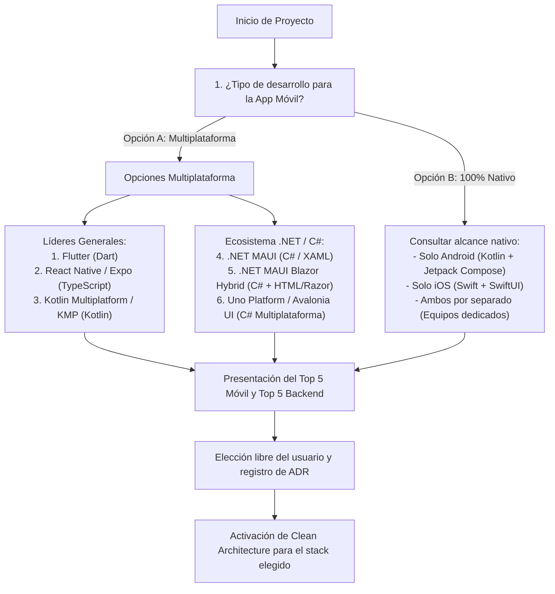

# AGENTE DE DESARROLLO MÓVIL Y BACKEND CON DEEPSEEK HARNESS

> **Entorno Profesional de Desarrollo Asistido por IA**  
> Diseñado para construir cualquier aplicación móvil (Android, iOS, Multiplataforma) y su backend completo con libertad tecnológica, arquitectura limpia, memoria continua y control de calidad gobernado por especificaciones.

---

## 1. Visión General y Filosofía

Este entorno implementa los principios avanzados de gobernanza de agentes de IA expuestos por **Eric Risco** y la filosofía de meta-arneses (**RSC Harness** y **DeepSeek Harness**):

1. **Evitar el "Vibe Coding" y el Síndrome de Frankenstein** (*Video 1 - ASDD*): No permitimos que un agente de IA programe durante horas a ciegas basándose en simples prompts. El desarrollo se guía por **especificaciones verificables** con puertas de aprobación humana.
2. **Fricción Proporcional al Riesgo** (*Video 2 - Metodologías Ágiles*): Se adaptan los procesos al tamaño del cambio. Tareas complejas usan **ASDD (Agent Spec-Driven Development)**; cambios directos y cotidianos usan **FTD (Fast-Track Development)**.
3. **Memoria Continua sin Empezar de Cero** (*Video 3 - RSC Brain / LLM Wiki*): Basado en el concepto *LLM Wiki* de Andrej Karpathy, el repositorio mantiene un **mapa de conocimiento vivo** (`02-DOCS/wiki/index.md`), un buzón de entrada (`inbox/`) y un registro histórico de decisiones de arquitectura (`decisions.md`).

---

## 2. Flujo Interactivo de Decisión Tecnológica

El agente nunca impone un lenguaje o framework; cuenta con un asistente interactivo (`skills/stack-advisor/SKILL.md`) que guía al usuario paso a paso:



### Opciones Sugeridas:
- **Top 5 Móvil Global**:
  1. **Flutter (Dart)**: Mejor balance de productividad, diseño UI consistente en todas las plataformas y gran rendimiento.
  2. **React Native con Expo (TypeScript)**: Acceso directo al ecosistema npm, componentes nativos y rapidez de desarrollo compartiendo código con web.
  3. **.NET MAUI / Blazor Hybrid (C#)**: Máxima sinergia si el desarrollador conoce C# o se conecta a un backend en .NET (permite compartir modelos DTOs al 100%).
  4. **Kotlin Multiplatform / KMP (Kotlin)**: Rendimiento y fidelidad nativa compartiendo la lógica de negocio y dominio en Kotlin.
  5. **Nativo Puro (Kotlin Compose / Swift SwiftUI)**: Máximo rendimiento, control y acceso sin intermediarios a las APIs de hardware de Apple y Google.
- **Top 5 Backend Global**:
  1. **ASP.NET Core Web API (C#)**: Rendimiento extremo con Kestrel, Entity Framework Core y compartición directa de contratos con apps en .NET MAUI.
  2. **Node.js / TypeScript (NestJS o Fastify)**: Ideal para sinergia con React Native (TypeScript end-to-end), arquitectura modular y validación con Zod.
  3. **Python (FastAPI)**: Desarrollo ultrarrápido de APIs asíncronas, validación con Pydantic y documentación OpenAPI interactiva.
  4. **Go (Gin o Fiber)**: Concurrencia masiva con goroutines, mínimo consumo de RAM y binario único autocontenido.
  5. **Supabase / PostgreSQL**: Base de datos relacional PostgreSQL con Auth, RLS y Storage para un time-to-market récord. *(Opción empresarial alternativa: Spring Boot con Java/Kotlin)*.

---

## 3. Estructura del Repositorio

```text
.
├── DEEPSEEK.md                        # Instrucciones maestras de DeepSeek Harness (en español)
├── AGENTS.md                          # Puente de compatibilidad universal para agentes
├── README.md                          # Este manual de referencia
├── .dsh/
│   └── hooks.json                     # Definición de hooks de ciclo de vida de DeepSeek Harness
├── .harness/
│   ├── config.json                    # Configuración general de guardias y ramas
│   └── hooks/
│       ├── session-start.sh           # Valida estado de constitución, tareas e inbox
│       ├── user-prompt-gate.sh        # Guardia de rama previa al prompt
│       ├── post-tool-guard.sh         # Guardia de archivos protegidos
│       └── session-stop.sh            # Cierre y log de sesión
├── 02-DOCS/
│   └── wiki/
│       ├── index.md                   # Mapa de conocimiento central (Knowledge Map)
│       ├── constitution.md            # Constitución inmutable del repositorio
│       ├── decisions.md               # Registro acumulativo de decisiones (ADR)
│       ├── inbox/                     # Buzón para depositar ideas, notas o requerimientos
│       ├── sdd/                       # Carril ASDD para desarrollo guiado por especificaciones
│       │   ├── templates/             # Plantillas de Spec, Plan y Review
│       │   ├── specs/                 # Especificaciones aprobadas
│       │   ├── plans/                 # Planes de tareas desglosados
│       │   └── progress/              # Registros de avance y Decision Queue
│       ├── ftd/                       # Carril FTD para cambios directos
│       │   └── templates/             # Plantilla de documento único FTD
│       └── knowledge/                 # Guías de Clean Architecture para Móvil y Backend
└── skills/
    ├── stack-advisor/                 # Habilidad de asesoramiento interactivo de tecnologías
    ├── asdd-orchestrator/             # Orquestador del ciclo formal de 5 etapas ASDD
    ├── ftd-runner/                    # Ejecutor del carril rápido FTD
    ├── brain-ops/                     # Ingesta de notas de inbox y memoria continua
    ├── mobile-clean-arch/             # Generador de patrones móviles y Offline-First
    ├── backend-clean-arch/            # Generador de patrones backend y RFC 7807
    └── api-contract-first/            # Metodología Contract-First (OpenAPI / DTOs)
```

---

## 4. Cómo Operar en el Día a Día

### A. Iniciar una Nueva Aplicación o Módulo (Carril ASDD)
1. **Paso 1**: El agente lanza el asesor de stack (`skills/stack-advisor/SKILL.md`) y dialoga contigo sobre si prefieres Multiplataforma (incluyendo .NET MAUI / Blazor) o Nativo, y propone el backend ideal.
2. **Paso 2**: El agente redacta la especificación en `02-DOCS/wiki/sdd/specs/<nombre>.md` respondiendo a las 4 preguntas obligatorias y definiendo el fuera de alcance.
3. **Paso 3 (Puerta Humana)**: **Tú revisas y apruebas la especificación**. El agente no escribirá código hasta contar con tu visto bueno.
4. **Paso 4**: El agente desglosa el plan de tareas en `plans/` y ejecuta tarea a tarea, registrando evidencia real observada de pruebas.
5. **Paso 5**: Se realiza la revisión de cierre contra la especificación inicial.

### B. Realizar un Cambio Puntual o Corrección (Carril FTD)
1. Se crea un documento único en `02-DOCS/wiki/ftd/<nombre>.md`.
2. Se describe la intención, el alcance y la lista de comprobación con criterios de prueba.
3. El agente implementa y pega la evidencia de cada prueba antes de marcar las tareas como completadas.

### C. Añadir Nuevas Ideas o Requisitos (RSC Brain / LLM Wiki)
1. Deposita tus notas, enlaces, grabaciones transcritas o requisitos en bruto dentro de `02-DOCS/wiki/inbox/`.
2. Pídele al agente: *"Procesa el inbox"* (se activará `skills/brain-ops/SKILL.md`).
3. El agente clasificará y consolidará la información en el mapa de conocimiento o generará una nueva especificación.

---

## 5. Integración con DeepSeek Harness (`dsh`)

DeepSeek Harness ejecuta automáticamente los hooks definidos en `.dsh/hooks.json`:
- `SessionStart`: Comprueba la constitución y avisa de notas pendientes en el inbox o tareas en curso.
- `UserPromptSubmit`: Recuerda no trabajar directamente en ramas protegidas (`main`).
- `PostToolUse`: Comprueba que no se alteren archivos protegidos sin autorización.
- `Stop`: Guarda el registro de finalización de la sesión.

---

## 6. Buenas Prácticas Universales Aplicadas
- **Clean Architecture**: Separación estricta entre Dominio (puro), Presentación y Datos.
- **Offline-First**: Persistencia local estructurada (SQLite/Room/SwiftData/Drift) y cola de mutaciones idempotentes.
- **Contract-First**: Contratos API acordados (OpenAPI / DTOs compartidos) antes de codificar la UI.
- **Seguridad**: Tokens en almacenamiento seguro cifrado (Keychain/KeyStore/SecureStorage) y respuestas de error estandarizadas (RFC 7807).
- **Atribución Git**: Todos los commits pertenecen al usuario humano sin firmas automáticas de IA.
