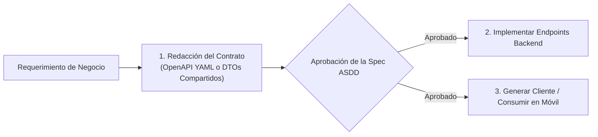

# HABILIDAD: DISEÑO DE APIS CONTRACT-FIRST

Esta habilidad garantiza que el contrato entre el backend y la aplicación móvil se diseñe, valide y apruebe **antes** de implementar la lógica o las pantallas.

---

## 1. El Flujo Contract-First

---

## 2. Métodos de Contrato según Stack

### Opción A: Contrato C# Compartido (.NET MAUI + ASP.NET Core)
- Se define una biblioteca de clases compartida `Shared.Contracts`.
- La solución .NET incluye el proyecto en la app MAUI y en el Web API.
- Cualquier cambio de tipo en un DTO genera un error de compilación inmediato en ambos proyectos si no se actualizan en conjunto.

### Opción B: Especificación OpenAPI 3.1 (Multi-lenguaje)
- El backend define o genera el esquema OpenAPI en `/swagger/v1/swagger.json`.
- La app móvil utiliza herramientas de generación de código:
  - **Flutter**: `openapi-generator-cli` $\rightarrow$ Modelos Dart y API client.
  - **React Native**: `orval` o `openapi-typescript` $\rightarrow$ Tipos TypeScript y hooks de TanStack Query.
  - **Kotlin / Swift**: Plugins Gradle/SwiftPM de generación OpenAPI.

---

## 3. Checklist de Validación del Contrato
Antes de considerar un contrato listo:
- [ ] Todos los endpoints definen sus códigos de estado HTTP esperados (200, 201, 400, 401, 403, 404, 422, 500).
- [ ] Las respuestas de error siguen el estándar RFC 7807 Problem Details.
- [ ] Los campos opcionales están explícitamente marcados como anulables (`nullable: true` o `?`).
- [ ] Las fechas siguen el estándar ISO 8601 en UTC (`YYYY-MM-DDTHH:mm:ssZ`).
