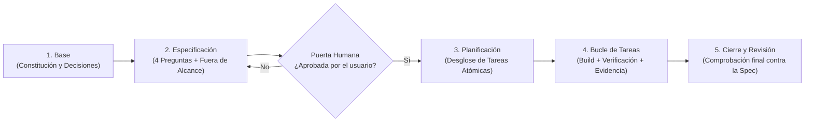

# HABILIDAD: ORQUESTADOR ASDD (AGENT SPEC-DRIVEN DEVELOPMENT)

Esta habilidad rige el desarrollo de características complejas, nuevos módulos, modelos de datos y decisiones arquitectónicas.

---

## 1. Las Cinco Etapas de ASDD

---

## 2. Protocolo de Ejecución Detallado

### Etapa 1: Base
- Consultar la Constitución en `02-DOCS/wiki/constitution.md`.
- Consultar las decisiones previas en `02-DOCS/wiki/decisions.md`.

### Etapa 2: Especificación (Spec)
El agente redacta el borrador en `02-DOCS/wiki/sdd/specs/<slug>.md` usando la plantilla `02-DOCS/wiki/sdd/templates/spec_template.md`. Toda especificación **debe responder obligatoriamente**:
1. **¿Qué puede hacer el usuario exactamente?**
2. **¿Qué resultado observable obtiene?** (Frente a una referencia aprobada: mock, contrato JSON, etc.).
3. **¿Qué decisiones y restricciones previas debe respetar?**
4. **¿Cómo se demuestra que funciona?** (Comando exacto de prueba y evidencia esperada).
5. **Fuera de alcance (Out of Scope)**: Qué NO se debe implementar para prevenir sobrediseño.

> [!IMPORTANT]
> **PUERTA HUMANA**: El agente se detiene aquí y solicita la aprobación explícita del usuario. NO debe escribir código de implementación sin esta confirmación.

### Etapa 3: Planificación (Plan)
Tras la aprobación de la spec, el agente desglosa las tareas en `02-DOCS/wiki/sdd/plans/<slug>.md`:
- Cada tarea es atómica y describe archivos a tocar y su criterio de verificación individual.
- Se identifican riesgos y se define la Cola de Decisiones (*Decision Queue*) para dudas que surjan en la marcha.

### Etapa 4: Bucle de Implementación por Tarea
Por cada tarea en el plan:
1. Implementar los cambios necesarios.
2. Ejecutar la prueba o comando de verificación.
3. Capturar la salida real (evidencia observada) y registrarla en `02-DOCS/wiki/sdd/progress/<slug>.md`.
4. Si la prueba falla: máximo 3 intentos de corrección. Si no se resuelve en el intento 3, detenerse y elevar la consulta al usuario mediante la Cola de Decisiones.

### Etapa 5: Cierre y Revisión
- Ejecutar la suite completa de pruebas del proyecto.
- Cumplimentar `02-DOCS/wiki/sdd/templates/review_template.md`.
- Presentar el resumen de evidencias al usuario para su autorización final de integración.
